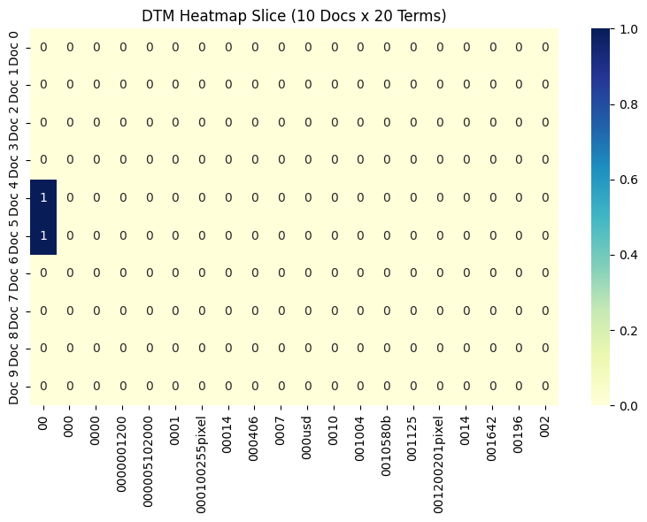

# Agentic Pipeline Report

**Student:** 謝旻憲  
**Student ID:** 109020030  
**Course:** Data Mining  
**Assignment:** Lab 1 – Agentic Pipeline

## 1. Dataset Selection and Data Exploration

I used the **20 Newsgroups** dataset to explore text mining techniques through an agentic pipeline. I selected four categories: `alt.atheism`, `soc.religion.christian`, `comp.graphics`, and `sci.med`. The dataset contained **2,257 documents** in total. These categories cover different subjects, making them suitable for comparing vocabulary and identifying patterns in text data.

I first instructed the agent to inspect the dataset (`inspect_data_2`), check for missing values (`check_missing_3`), and examine duplicate records (`check_duplicates_4`). The results showed no missing text records or duplicate documents. This indicated that the selected dataset did not require additional missing-value treatment or duplicate removal.

Next, I examined descriptive statistics (`describe_data_5`) and sampled five documents (`sample_data_6`). These steps helped me understand the structure and content of the text data before applying more advanced methods.

## 2. Document-Term Matrix and Text Visualization

I used `build_dtm_7` to construct a **Document-Term Matrix (DTM)**, which represents documents as rows and terms as columns. The resulting matrix had **2,257 rows and 35,788 columns**, with a sparsity of approximately **99.55%**.

The high sparsity is expected because each document contains only a small proportion of the vocabulary found across the entire dataset. This also demonstrates why sparse matrix operations are useful for large text datasets.

Using `term_frequency_8`, I examined common terms in the dataset. Frequent terms included general English words such as *the*, *of*, and *to*. I also generated a DTM heatmap (`dtm_heatmap_9`). The selected 10-document-by-20-term heatmap contained very few nonzero entries, reflecting the sparsity of text data.

## 3. Feature Filtering and Correlation Analysis

Because the DTM contained a large number of features, I used feature filtering to reduce the number of terms considered in subsequent analysis.

The variance filtering result (`variance_filter_10`) retained **5,354 out of 35,788 features** using a threshold of 0.01. This kept approximately 14.96% of the original vocabulary. Variance filtering is useful because terms with little variation across documents may provide limited information for distinguishing documents.

I also applied Pearson correlation (`pearson_filter_11`) and Spearman correlation (`spearman_filter_12`) using membership in `comp.graphics` as the target. These methods measure relationships between term occurrence and category membership in different ways. Pearson correlation captures linear relationships, while Spearman correlation evaluates rank-based relationships.

Finally, I generated a feature correlation matrix (`feature_correlation_matrix_13`). The results showed a strong positive correlation between common words such as *the* and *of*. This suggests that frequent terms may exhibit similar usage patterns without necessarily representing the main topics of the documents.

## 4. Frequent Pattern Mining

I selected the `comp.graphics` category for frequent pattern mining because it contains documents related to computer graphics and provides an opportunity to identify recurring technical vocabulary.

I used TF-IDF filtering and the FP-Growth algorithm with a minimum support count of **50 documents**. The analysis covered **584 documents** and produced **3,495 frequent patterns** (`mine_patterns_16`).

The most frequent patterns included `lines` and `subject`, each appearing in 584 documents, and `organization`, appearing in 560 documents. However, these terms are likely associated with the email header structure of the original Newsgroups dataset rather than the actual discussion topics.

To better understand the results, I performed an additional exploratory screening that excluded patterns containing selected header-related terms. This reduced the displayed set from **3,495 to 132 patterns**, including **44 patterns containing at least two terms**. This was a post-processing comparison; it did not change the original mining result.

For example, the pair `{graphics, university}` had a support count of **101**, while `{know, graphics}` had a support count of **75**. These values represent the number of documents containing both terms, not the number of times the words occurred.

## 5. Interpretation, Limitations, and Conclusion

The main finding is that frequent pattern mining can identify common vocabulary and term combinations in a document collection. However, **high support does not automatically imply that a pattern is meaningful**. In this dataset, email headers strongly influenced the results.

For example, the pattern `{world, distribution}` may come from header text such as `Distribution: world`, while `university` may describe the sender's institutional affiliation. These patterns may reflect document formatting rather than the subject of computer graphics.

An important improvement for future analysis would be to remove email headers before creating the DTM, then repeat feature selection and frequent pattern mining. This would help separate meaningful document content from metadata.

Through this pipeline, I practiced data inspection, document-term representation, feature filtering, correlation analysis, visualization, and frequent pattern mining. I also encountered and resolved a Windows text-encoding issue affecting the PAMI transaction file used by the pattern-mining tool. The corrected implementation passed both the original tool test and an additional Unicode regression test.

Overall, this exercise showed me that data mining requires more than running algorithms successfully. **Data preprocessing and interpretation are essential for obtaining meaningful results**, especially when working with unstructured text.