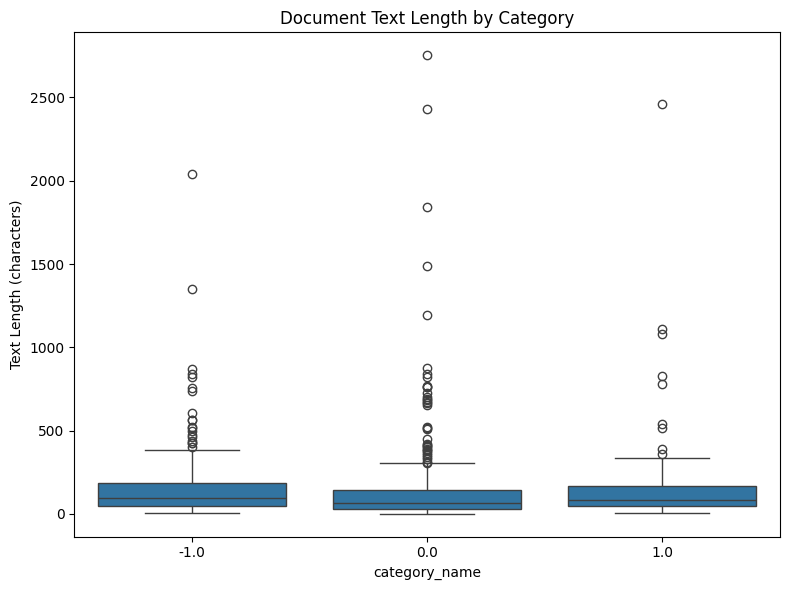
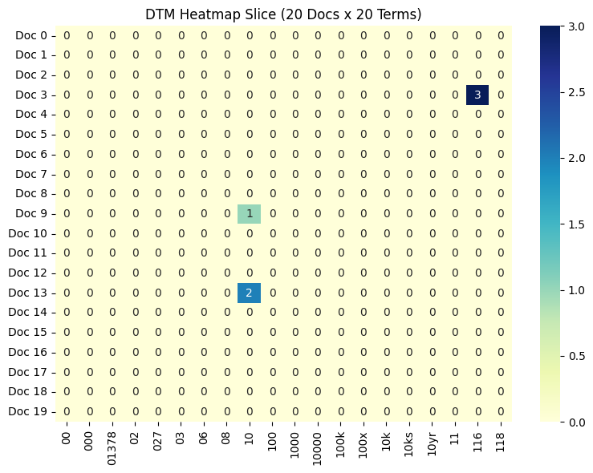
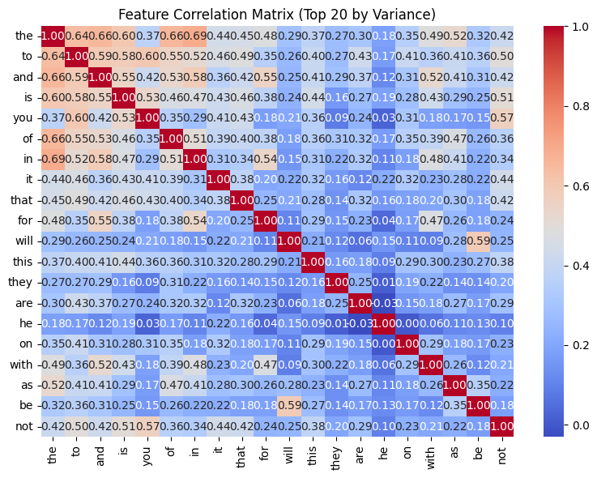
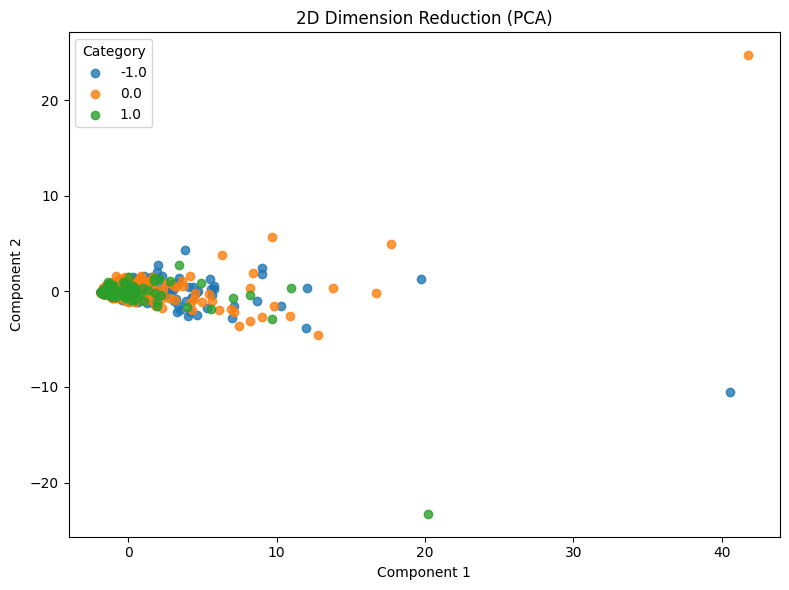

# Homework Report – Reddit Stock Sentiment Analysis

**Student:** 謝旻憲  
**Student ID:** 109020030  
**Course:** Data Mining  
**Assignment:** Lab 1 – Homework

## 1. Dataset and Data Cleaning

For this homework, I used the Reddit Stock Sentiment dataset to test whether the data mining tools developed earlier could work on a different dataset. The original dataset contained 847 Reddit posts or comments with three sentiment labels: negative (-1.0), neutral (0.0), and positive (1.0).

I loaded the dataset using `load_dataset_1` and inspected its structure using `inspect_data_2`. The loader converted the original `label` column into standardized `category` and `category_name` columns. I initially requested the original `label` column and encountered an error, which helped me understand the normalization performed by the loader.

The missing-value check (`check_missing_3`) found no missing or empty text values. The duplicate check (`check_duplicates_4`) identified 23 extra duplicate records. However, calling the duplicate-removal tool (`check_duplicates_5`) removed all 34 rows belonging to duplicate groups, leaving 813 documents. To preserve one representative from each group, I reconstructed the working dataset from the original CSV using `drop_duplicates(keep="first")`.

The final cleaned dataset contained **824 documents**: 315 negative, 401 neutral, and 108 positive. This was an important example of a tool behaving differently than expected and needing its output to be verified.

## 2. Descriptive Statistics and Text Preprocessing

I used `describe_data_6` to analyze document lengths. The overall mean text length was **148.15 characters**, while the median was **79.5 characters**. The shortest document contained 1 character, and the longest contained 2,753 characters. The difference between the mean and median suggests that some unusually long posts affect the average.

The average text lengths were 153.74 characters for negative posts, 139.13 for neutral posts, and 165.33 for positive posts. Positive posts were slightly longer on average, but the boxplot showed substantial variation and several outliers across the categories. Therefore, text length alone does not appear sufficient for distinguishing sentiment.

I then applied NLTK unigram tokenization (`tokenize_7`) and constructed a Document-Term Matrix (`build_dtm_8`). The resulting matrix had **824 documents and 4,346 terms**, with 16,813 nonzero entries and **99.5305% sparsity**. This indicates that each post uses only a small fraction of the vocabulary.

## 3. Term Frequency and Feature Filtering

Using `term_frequency_9`, I found 20,519 total term occurrences. The most frequent terms were `the` (886), `to` (557), `and` (475), `is` (390), and `it` (341). These are common English stopwords, showing that high frequency does not necessarily mean high usefulness for sentiment analysis.

The DTM heatmap (`dtm_heatmap_10`) displayed a 20 × 20 slice of the matrix. Most entries were zero, which was consistent with the extremely high overall sparsity. Some numerical expressions were also retained as vocabulary terms, suggesting that additional text preprocessing could improve the representation.

I applied variance filtering (`variance_filter_11`) using a threshold of 0.01. This reduced the vocabulary from **4,346 terms to 493 terms**, retaining approximately **11.34%** of the features. Variance filtering helps reduce the feature space, although a high-variance term is not necessarily informative about sentiment.

## 4. Pearson and Spearman Correlation Analysis

I compared Pearson and Spearman feature filtering with positive sentiment as the target category. Pearson filtering (`pearson_filter_12`) retained **4,213 terms**, while Spearman filtering (`spearman_filter_13`) retained **4,227 terms**, both using a threshold of 0.01.

The two methods produced similar rankings for several terms, including `technology`, `huge`, `nice`, and `potential`. These words may be associated with positive sentiment. However, correlation coefficients were not provided for the ranked terms, so I cannot determine the strength of their associations from the rankings alone.

I also generated a feature correlation matrix (`feature_correlation_matrix_14`) for 20 high-variance terms. Strong correlations included `in` with `the` (0.6927), `and` with `the` (0.6601), and `of` with `the` (0.6599). Since these pairs mainly involve stopwords, the results show that correlated word usage does not necessarily reveal meaningful financial sentiment.

## 5. PCA Dimension Reduction

I applied Principal Component Analysis using `reduce_dimensions_15` to reduce the original 4,346-dimensional document vectors into two dimensions.

The first principal component explained **26.75%** of the variance, and the second explained **5.07%**, giving a combined explained variance of **31.82%**.

The PCA scatterplot showed substantial overlap between negative, neutral, and positive posts rather than three clearly separated clusters. Several outliers were also visible. This suggests that two-dimensional PCA of the current text representation does not clearly distinguish sentiment classes.

## 6. Frequent Pattern Mining

I used FP-Growth to mine patterns from the **108 positive-sentiment documents**, with TF-IDF feature filtering.

With a minimum support of 15 (`mine_patterns_16`), the algorithm found only **one frequent pattern**, the word `just`, with support 15. I then reduced the minimum support to 5 (`mine_patterns_17`), which increased the result to **16 frequent patterns**.

The frequent terms included `just` (15), `good` (12), `doing` (9), `economy` (6), `market` (6), and `technology` (5). Some terms were related to financial discussions or positive language. However, all 16 patterns were single terms; no multi-term combinations met the support threshold.

This comparison demonstrates that lowering the minimum support increases the number of patterns, but does not guarantee that the patterns are more meaningful. The relatively small number of positive documents may also limit how often specific word combinations occur.

## 7. Conclusion and Limitations

This homework allowed me to reuse the tools developed for the 20 Newsgroups dataset on Reddit stock sentiment data. The tools successfully supported data inspection, tokenization, document-term matrix construction, feature filtering, correlation analysis, visualization, dimension reduction, and frequent pattern mining.

An important finding was that the tools were generally reusable, but their results still required careful validation. In particular, the duplicate-removal tool removed entire duplicate groups instead of keeping one representative. The normalized category labels also required attention because positive sentiment was encoded as category 2 rather than category 1.

Several improvements could make the analysis more meaningful. Removing stopwords and unnecessary numerical tokens, using TF-IDF representations for dimension reduction, and evaluating class imbalance could improve the interpretation of the results.

Overall, the exercise showed me that a successful tool execution is only the beginning of a data mining analysis. **Understanding preprocessing choices, checking tool behavior, and interpreting results carefully are essential for drawing useful conclusions.**